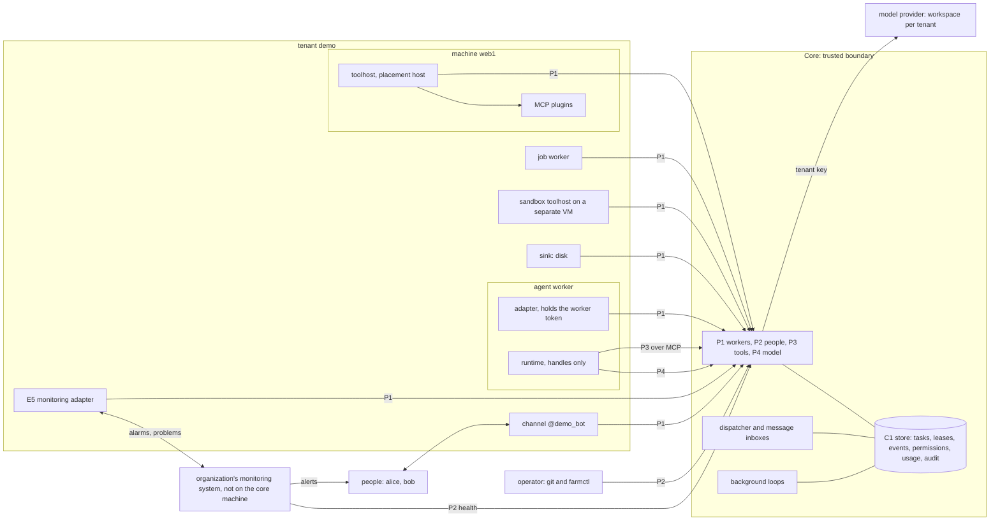

# Architecture

## In short

botaru is the skeleton of a bot farm for work tasks: concepts, lifecycles, contracts at the boundaries and the rules that any implementation must keep. Bots work for several tenants; people talk to them through channels, and external programs enqueue tasks with their own key (D-01, D-47). The farm is a thin core with replaceable edges. The core holds every decision: who may do what, what goes to whom, how much was spent, what is written to the audit. The model only proposes, and its text never becomes a command. Everything else (agents, pipelines, tool executors, channels, sinks, the monitoring adapter) is a worker that takes work from the core itself. Contracts with checks exist only at the boundaries with foreign code: workers (P1), channels (E1), tool plugins (P3 with E3), the model provider (P4) and the monitoring system (E5) (C10, D-114); the other ports describe how the core is built. Every record belongs to exactly one tenant, and nothing crosses that wall. Anything new is added by a manifest in git or by an implementation behind a port, without editing the core (D-02).

This is the entry document. It shows the farm on one screen, the layers of the skeleton, the core and its parts, the boundaries, the tenant wall and the trust boundary, and follows one message from start to finish.

## How it works

### What the skeleton is

The skeleton is text and data: the model in words, port pages, schemas, lifecycles, the rule registry with checks, fixtures, examples on the tenants `demo` and `demo2`, the eval case format and a deployment topology. Its only executable code is the `ci/` checks. The reference implementation is written in Go in `impl/` (D-91, D-92): the core, `farmctl`, the black-box runner, channel adapters and its own agent runtime (D-93). It does not edit skeleton files and passes the `conformance/` suite. Anything that passes the suite is an implementation.

The skeleton is public, so it holds no secrets and nothing tied to an organization: only the tenants `demo` and `demo2`, the people `alice`, `bob`, `carol`, `erin`, the bot `@demo_bot`, the domain `example.org`, addresses from documentation ranges and the time zone `Europe/Berlin`. Core records name a person by the opaque id `human:p_<ULID>` (D-85).

| Layer | What it contains | Where it lives | How it changes |
|---|---|---|---|
| 1. Model | concepts, relations, lifecycles, rules | `docs/`, `docs/model/`, `spec/lifecycles/`, `conformance/requirements.yaml` | a decision D-NN; an ADR if a contract changes |
| 2. Ports | the meaning of each boundary operation; descriptions of the core's parts | `spec/ports/` | a new operation is a minor version of its sheet |
| 3. Contracts and checks | JSON Schema, closed registries, bindings, fixtures, suites | `spec/model/`, `spec/manifests/`, `spec/bindings/`, `conformance/` | only additions inside a version |
| 4. Implementations | the core, `farmctl`, adapters, runtimes | `impl/` (D-92), others anywhere | constantly |

**One source per fact.** The shape of data lives only in JSON Schema, a rule only as a registry row, a lifecycle only in its file, a port operation only as a sheet row, a refusal reason only in `spec/model/reasons.yaml`. Everything else refers by identifier (the OpenAPI operation `wp.claim` -> `P1.claim` -> [FEN-2](../conformance/rules.md#FEN-2) -> "lease"), and `ci/` checks the references.

### The farm on one screen

Work is pulled: every arrow of a worker points to the core. The core reaches outside only to the model provider, through P4. The organization's monitoring system watches machines and services and wakes people; the farm hands it alarms through the E5 adapter, and the monitoring system checks that the core is alive by polling P2 `health` from another machine (D-59, D-60, D-62).



| Who | What it is |
|---|---|
| Core | the core process, background loops, the P3 and P4 gateways, the store logic; the only place where decisions are made |
| Tenant | whose data and whose money, such as `demo` and `demo2`; a wall nothing crosses |
| Service tenant `farm` | what belongs to the farm as a whole: the farm manager seat registry, operator permissions, holds of the scopes `farm` and `seat` |
| Principal | on whose behalf work runs: a person (`human`), an external program (`service`), the farm (`system`) |
| Worker | a process that takes work through P1 `claim`: `agent`, `job`, `toolhost`, `channel`, `sink`, `monitor` |
| Bot | an identity with a number, a role, a persona and memory that outlives its workers ([bots.md](bots.md)) |
| Role and role profile | a role sets task types, tools and models; its profile, from the closed list `spec/model/role-profiles.yaml`, sets what such a bot can be at all and its rank ceiling (PRF-1) |
| Monitoring system | the organization's own system that watches machines, wakes people and holds scripts ([operations.md](operations.md)) |
| Operator | a person with `admin:*` in `farm` who works only through `farmctl` and git |
| Commission, farm manager | the tenant's reviewer bots ([improvements.md](improvements.md)); one manager bot per farm in a seat a person appoints ([farm-manager.md](farm-manager.md)) |

A personal assistant is a `worker` bot whose worker has an owner; it takes only its owner's tasks (IDN-5, D-22).

### The core and its parts

| Part | What it does | Where it is described |
|---|---|---|
| Store C1 with the queue | atomic transitions of tasks, leases, calls, approvals, deliveries, events, usage and audit; the queue in C1 is the farm's pool, partitioned by tenant. Reference: PostgreSQL (D-03) | `spec/ports/c1-task-store.md` |
| Dispatcher | decides what `claim` returns, deterministically and only through `claim` (DSP-1, DSP-2) | [coordination.md](coordination.md) |
| Message inboxes | messages between bots, published only in the transaction of a successful `complete` (MSG-9) | [messaging.md](messaging.md) |
| P1 WorkerProtocol | the only entry point of workers | `spec/ports/p1-worker-protocol.md` |
| P2 AdminAPI | everything people change; the client is `farmctl` | `spec/ports/p2-admin-api.md` |
| P3 ToolGateway | the only source of tools for the runtime; an MCP server inside the core (D-45) | `spec/ports/p3-tool-gateway.md` |
| P4 ModelGateway | a model call with check, reserve and charge, on the tenant's key (D-45) | `spec/ports/p4-model-gateway.md` |
| C2 Authorizer | the "allowed or not" decision in the same transaction as the transition | `spec/ports/c2-authorizer.md` |
| C3, C4 | conversation transcripts; person memory and bot facts | `spec/ports/c3-session-store.md`, `spec/ports/c4-memory-store.md` |
| Background loops | expired leases, schedules, deliveries, deadlines, erasure, rollups, alarm export; each marks its tick, and P2 `health` reports from the ticks (MON-2). They never call the model | `spec/ports/background-loops.md` |

`farmctl` is the people's client of P2: it applies manifests from git, records people and workers, sets holds and shows state. Every command goes through the same permission checks and the audit (AUD-1). On the core machine it counts as a core process (DEP-8), so `farmctl hold farm` can stop the whole farm straight in C1 when the core process is down (HLD-1).

There is no MCP server between the runtime and the core other than P3; the tool handle travels in the header of every request. So the runtime holds no worker token (DEP-5), and the core records each tool call itself; the right toolhost takes it through `claim`. An external program is a `service` principal with groups like a person (D-47): it calls P1 `enqueue` and reads its own tasks with `task.get`.

### Boundaries and descriptions

The full port list, with references and main rules, is in [spec/ports/README.md](../spec/ports/README.md). It has two kinds of pages.

**Contract boundaries** are where foreign code meets the farm. Their sheets hold operations, refusals and guarantees, and a conformance suite checks them (C10, D-114):

| Boundary | Who is on the other side |
|---|---|
| P1 WorkerProtocol and E1 Channel | every worker; the messenger and the people in it |
| P3 ToolGateway and E3 ToolHost | tool plugins (MCP servers), on catalog machines or in a sandbox |
| P4 ModelGateway | the model provider |
| E5 Monitor | the organization's monitoring system |

**Internal descriptions** say how the core is built and which rules each part serves, without request and response tables: P2, C1-C4, the sink E2, the agent runtime E4, the test-control port, the consent adapter and the background loops. A page that has no second implementation stays a description (D-46, D-80, D-114).

One handout mechanism, a lease with a fencing token, serves an attempt, a tool call and a delivery, so every edge speaks the same protocol. What all ports share (principal from the credentials, one error shape, bearer handles, `not_ready`, idempotency, erasure, telemetry) is listed once in "Common to all ports" of the ports README.

### The agent runtime

An agent worker has two parts. The adapter holds the worker token and speaks P1: `hello`, `claim(attempt)`, `heartbeat`, `complete` or `fail`. The runtime runs the model loop with only what the attempt work item gives it: the body, the trusted instruction, the handles for P3 and P4 and the run limits. It has neither the worker token nor the provider key (DEP-5). The page is `spec/ports/e4-agent-runtime.md`.

The worker declares its runtime in the `runtime` object of P1 `hello`, with values only from `spec/model/runtime-deviations.yaml`: `session`, `memory`, `model_attribution`, `catalog`, `built_in_tools` and, from v0.2, `skills`. The first value of each field is the farm model; any other value turns on its non-waivable replacement rule (RT-1..5, INJ-9), and a declaration the core cannot accept blocks the worker. The core sets the limits of each run (`max_turns`, `run_max_input_tokens`, `deadline`) in the `limits` of the attempt work item, and the runtime stops at the first one it reaches (BUD-9). Money does not depend on them: P4 reserves and charges every call whatever the runtime does, and rejects a request with a tool outside the P3 catalog (GW-1). A runtime that "forgot" to turn off a built-in tool fails at the gateway instead of gaining a capability.

### Tenants and the service tenant `farm`

A tenant answers "whose data is this and whose money". Seven rules hold the wall, [TEN-1](../conformance/rules.md#TEN-1) to [TEN-7](../conformance/rules.md#TEN-7): one record, one tenant; the tenant and the principal from the credentials; work only of one's own tenant, and a tool call only for the toolhost its `target` names (TEN-3a); one tenant per process; no mixing of data or model context; no tenant data in global manifests; references only to one's own objects. Every tenant has its own workspace, key and ceilings at the model provider, and only P4 holds the key (D-42, GW-3). A tenant is `kind: test` or `kind: production` and has limits on its queue, enqueues and disk; going over gives `over_capacity`, not a slowdown for everyone (CAP-1). A tenant appears only from a manifest in git and `farmctl apply` (MAN-5).

There is no main tenant. The service tenant `farm` holds only the farm manager seat registry and the holder's identity as numbers and codes, the operators' permissions and the holds of the scopes `farm` and `seat`. It makes no model calls. The farm manager's tasks are records of the tenant they concern, run by workers enrolled there, on that tenant's key and its `manager` line (MGR-3, MGR-24). One attempt sees exactly one tenant, and a view of the whole farm is built only by core code from allowlisted metadata (TEN-5).

The farm operator is a person with `admin:*` in `farm`. Operator operations are the closed list [PRM-14](../conformance/rules.md#PRM-14): `apply`, workers, `chat.bind`, privileged groups, seats, holds of `farm` and `seat`, redrive of dead work. They go only through `farmctl` with the operator's own P2 credentials, never from a channel (IDN-7).

### Three object origins and the write rule

| Origin | Truth and change | Examples |
|---|---|---|
| Declared | git; `farmctl apply`, atomic and idempotent (MAN-6) | `Tenant`, `Role`, `TaskType`, `ToolPlugin`, `Action`, `Catalog` |
| Recorded | the store; a person's P2 command with audit | principal, membership, chat binding, worker, hold, seat |
| Working | the store; only transitions of its own lifecycle | task, lease, tool call, approval, delivery, fact, proposal |

**The write rule.** A sender writes only the body of a task or message, or the `spec` of a manifest. System fields and status are written only by the core, and the schema rejects a request that carries them ([IDN-1](../conformance/rules.md#IDN-1)). So neither the model nor a foreign program can substitute `tenant`, `initiator`, `max_tier`, `data_mark`, `untrusted_seen` or `approval_id`. Every new object of the skeleton states which of its fields only the core writes.

A manifest always sits in one wrapper:

```yaml
apiVersion: botaru/v1alpha1
kind: Role
metadata:
  name: ops-reader
  tenant: demo        # only for kinds that belong to a tenant
  labels: {}
spec: { }             # schema spec/manifests/<kind>.schema.json
# status is not in git: the core keeps the applied commit, the set hash and errors
```

An object that disappeared from git is shown by `apply` with its dependents and is not deleted (MAN-2). Whether live plugins match their manifest is checked at the toolhost's `hello` (INJ-2).

### Trust boundary and placement

Inside the trusted boundary are the core, the store C1 and the gateways P3 and P4 with the provider keys. Only core processes have credentials and a network path to the store (DEP-8). That the model has no shell on a production machine is held by schemas, lint and placement, not by a reviewer (INJ-1, DEP-1).

| Machine | What runs on it | Why |
|---|---|---|
| Farm nodes (`core1`, `backup1`) | the core, C1, channel processes, monitoring adapters; backups on a node other than the core | a farm node is never a tenant catalog resource and runs no tenant toolhost (DEP-11) |
| Tenant catalog machines (`web1`, `db1`, `ctd1`) | toolhosts `placement: host`; writes only through a separate action toolhost and a narrow OS mechanism (`oneshot` for actions, `unit` for services) | no shell and no free-form input on a production machine (DEP-1, DEP-4, MON-8) |
| Sandbox VM | toolhosts `placement: sandbox` | free-form input only here, without production data, network or secrets (DEP-3) |
| Agent machine | adapters and runtimes in their own containers | the runtime reaches only P3, P4 and its adapter (DEP-5) |
| Monitoring system | outside the farm nodes | polls P2 `health` with its own key and wakes people by its own path; without it, a watchdog and the core deliver alarms (MON-2, MON-13, D-88) |

The topology is `deploy/compose.example.yaml`, and the deployment description is data the lint checks (DEP-10). Threats, placement and people's data are explained in [permissions.md](permissions.md) and [operations.md](operations.md).

### Contract formats and versions

Data, task bodies, manifests and events are JSON Schema 2020-12, the single source of types, with string formats from `spec/model/formats.yaml`. P1 over HTTP is OpenAPI 3.1 generated from the operation map, events are CloudEvents 1.0 with `spec/bindings/events/catalog.yaml`, tools are the MCP tool protocol with the revision set in `spec/bindings/mcp/`, and writes on machines use the OS mechanisms `oneshot` and `unit` (`spec/bindings/os/systemd.md`). Port pages are Markdown with MUST, SHOULD and MAY per RFC 2119.

The repository version is SemVer 0.y.z in `spec/VERSION`. Skeleton versions v0.1 to v0.3 are content slices: from which version a rule is checked (D-80, D-113). Within `.vN` of a task type, event or schema only optional fields are added; a breaking change is `.v(N+1)` next to it (MAN-3), and `ci/check-additive` checks this. Manifests carry `apiVersion: botaru/v1alpha1` until 1.0.0 (D-44). The core accepts the current and the previous major P1 version (LCY-7) and drains before a rollout (LCY-6). Every secret has a rotation recipe in [operations.md](operations.md) with two valid values during a rotation. The full map and what compatibility promises before 1.0.0 are in [spec/versions.md](../spec/versions.md).

### Conformance profiles

An implementation declares `conforms_to: {skeleton: <version>, profiles: [core, ...]}`, visible in P2 `status`. The black-box runner (`conformance/runner.md`) checks the active rules of the claimed profiles whose version is not newer than the claimed one (MAN-8). A non-waivable rule in the expected failures file fails the run. The runner drives clocks, loop ticks and faults through `spec/ports/test-control.md`, which exists only on a test bench (D-85, D-86).

| Profile | What is in it |
|---|---|
| `core` | tenants, runtime, leases, tasks, deliveries, permissions, approvals, security, holds, alarms and monitoring, money, the dispatcher (DSP, STA); mandatory |
| `messaging` | messages between bots, inboxes, the reporter |
| `campaign` | campaigns, scripts, the translator |
| `insights` | observations, analysis, proposals, the commission, the change trial |
| `manager` | the farm manager |
| `governance` | bot identities, seats, bot memory |

So a first implementation can conform for the core without the farm manager. The exact profile of every rule is in `conformance/requirements.yaml`.

### Repository layout

The folders follow the layers: `docs/` is the model in words, `spec/` the public API (schemas and closed registries, manifests, lifecycles, ports, bindings), `conformance/` the registry, fixtures, suites and the runner contract, `examples/` the tenants `demo` and `demo2`, `evals/` the eval cases, `deploy/` a topology that is not runnable, `ci/` the skeleton checks and `impl/` the reference implementation. The table is in the [README](../README.md#layout).

### Decisions (ADR)

ADRs live in `docs/adr/` in MADR 4.0.0 format; their "Confirmation" section refers to rule numbers. An ADR is needed for a decision that changes a contract: an operation or guarantee of a boundary sheet, a wire schema, a lifecycle state, a closed list that permissions depend on (D-86 (13)). Also for a new auto-stop rule, message genus, dispatcher condition, fact kind or predicate, role profile, or a manifest kind that affects permissions (MAN-4). An ordinary new rule is a registry row that refers to a decision D-NN. If an extension needs the core changed, the skeleton lacks a port: that is a reason for an ADR, not a workaround.

The table lists the fundamental ADRs; each is a file in [adr/](adr/README.md) with the status `accepted`, and the decision it records is a row in [decisions.md](decisions.md) or part of the skeleton text. A new ADR takes the next free number, 0011.

| No. | ADR | What is decided | Decision |
|---|---|---|---|
| [0001](adr/0001-skeleton-from-the-model.md) | A skeleton from the model; contracts only at the boundaries | concepts, lifecycles and rules first; contracts only where foreign code meets the farm | D-38, D-66, D-114 |
| [0002](adr/0002-thin-core-queue-in-store.md) | A thin core, the queue in the store | the queue in C1, reference PostgreSQL | D-03 |
| [0003](adr/0003-one-lease-task-states-events-schemas.md) | One lease for all work; task states; events; schemas | a lease with a fencing token; A2A terminal states; CloudEvents 1.0; JSON Schema 2020-12 and OpenAPI 3.1 for P1 | skeleton text |
| [0004](adr/0004-deployment-api-version-idempotency.md) | Deployment; `apiVersion`; idempotency scope; no `input_required` | containers and compose; `botaru/v1alpha1`; `(tenant, idempotency_key)`; a clarification is a new task | D-08, D-44, D-43, D-41 |
| [0005](adr/0005-gateways-in-core-internal-ports.md) | P3 and P4 inside the core; internal ports as descriptions | no intermediary between runtime and core; a port without a second implementation is a description | D-45, D-46, D-80, D-114 |
| [0006](adr/0006-tenant-workspace-service-principal.md) | A workspace per tenant; a program as a principal | own provider workspace, key and ceilings; a `service` principal | D-42, D-47 |
| [0007](adr/0007-bot-messages-campaigns-scripts.md) | Bot communication; campaign; script and translator | typed messages published at `complete`; one approval of a plan snapshot; a closed plan run by the initiator's button | D-14, D-32, D-20, D-15 |
| [0008](adr/0008-external-monitoring-service-control.md) | External monitoring; service control | alarms and liveness through E5; catalog services by role permission, only `restart` from `no_card` without a card | D-59..D-64, D-66..D-70, D-73, D-74, D-82 |
| [0009](adr/0009-proposals-commission-identity-manager.md) | Proposals, the commission, identity, the farm manager | a bot proposes, code counts, a person decides; an identity grants nothing; `farm` holds only the seat registry | D-16, D-115, D-19, D-21, D-30, D-33 |
| [0010](adr/0010-agent-runtime-and-language.md) | Agent runtime; implementation language | own loop over P4; Go in `impl/` | D-93, D-91, D-92 |

All of them have the status `accepted`.

### What the skeleton does not decide

Every open decision has a port, a binding or a closed list that absorbs it. The skeleton does not choose: a model provider beyond the reference (`spec/bindings/model-providers/README.md`, D-85); a monitoring system (the E5 boundary; without one, a single server with a minimal alarm path, D-88); channels and sinks beyond the references (drivers under the meta-schema, MAN-4); hosting and OS (`deploy/compose.example.yaml`, OS names only in bindings); the store engine beyond PostgreSQL (D-03); sandbox technology; personal data law and the payment model (D-12); external agents over A2A (an adapter before `enqueue`). Rule texts name no products: those names live only in bindings, the E5 sheet, [operations.md](operations.md) and examples (D-66).

### Where to read next

| Document | About |
|---|---|
| [goals.md](goals.md) | what the farm is for; every rule names its goal |
| [model/glossary.md](model/glossary.md), [model/relations.md](model/relations.md) | terms; objects and cardinalities |
| [task-language.md](task-language.md) | task body, catalog, tiers |
| [tasks-and-delivery.md](tasks-and-delivery.md) | task, lease, tool call, delivery |
| [permissions.md](permissions.md) | groups, approvals, human decisions, threats, placement |
| [messaging.md](messaging.md) | bot messages, inboxes, the reporter |
| [coordination.md](coordination.md) | dispatcher, bot groups, managers, campaigns, scripts, the translator |
| [operations.md](operations.md) | holds, alarms, backups, monitoring, people's data and erasure |
| [capabilities.md](capabilities.md) | files, knowledge, skills, external events |
| [models-and-money.md](models-and-money.md) | model profiles, budgets, the model gateway |
| [improvements.md](improvements.md) | observations, proposals, the commission, the change trial |
| [bots.md](bots.md) | bot identity, persona, memory, retirement |
| [farm-manager.md](farm-manager.md) | the farm manager and incidents |
| [quality.md](quality.md) | eval and readiness |
| [extending.md](extending.md) | recipes for adding parts without changing the core |
| [decisions.md](decisions.md), [open-questions.md](open-questions.md) | decisions with dates; what is not decided yet |
| [spec/README.md](../spec/README.md), [spec/ports/README.md](../spec/ports/README.md), [conformance/runner.md](../conformance/runner.md) | for implementers |

## Why it works this way

- **The model comes first.** Concepts, lifecycles and rules come before formats, so the same operation means the same in any binding.
- **Code decides, the model proposes.** Permissions, addresses, budgets, alarms and records are core code; model text is untrusted and carries out nothing.
- **Contracts only where foreign code is.** A contract costs a sheet, a suite and a compatibility promise. It pays only where someone else writes the other side: workers and channels, plugins, the provider, the monitoring system. Inside the core a description is enough (D-114).
- **One handout mechanism.** The same lease serves attempts, calls and deliveries, so all edges speak one protocol and one suite checks them.
- **The boundary is checked by machinery.** Closed schemas, placement and the deployment lint hold "no shell for the model on a production machine" without a reviewer.
- **One wall between tenants.** The tenant comes only from the credentials, so data and money never mix, not even for the farm manager.
- **We do not duplicate what others do.** The organization's monitoring system already watches machines and wakes people; the farm watches only what it cannot see: tasks, bots, money, secrets (D-59, D-60).
- **People on the other side of the interface.** The farm shows people cards and summaries and takes buttons and commands; it does not model them.

## Example on `demo`: one message from start to finish

`alice` writes to `@demo_bot` in a private chat: "why was the site slow yesterday?".

| # | Who | What happens | Rules |
|---|---|---|---|
| 1 | channel | verifies the update and the sender, builds an `Activity` and calls P1 `submit_activity`; a repeated update makes no second task | IDN-3, DLV-5 |
| 2 | core | the channel identity gives the principal `alice` in `demo`. Code, not the model, picks the type `ops.investigate.v1` from a command or `default_types`. C2 checks permissions, the budget is reserved, the task gets the mark `raw_logs` and `max_tier: 1` | TEN-2, IDN-6, PRM-2, BUD-1 |
| 3 | dispatcher, agent | an attempt goes to a worker of role `ops-reader` through `claim`: a lease and the P3 and P4 handles; the adapter keeps its token from the runtime | FEN-1, DSP-2, SEC-3, DEP-5 |
| 4 | runtime, P3, P4 | the runtime lists tools from P3 and calls the model through P4, which checks the tools against the catalog, reserves the worst case and charges the actual usage | GW-1, GW-2 |
| 5 | P3, toolhost | the model calls `logs/tail` on `host-web1`. The core checks permissions and the closed parameters, computes the target (`demo`, `logs`, host, `web1`) and records the call; the `demo` toolhost on `web1` takes it and redacts the output. The core wraps the output and sets `untrusted_seen` | TEN-3a, INJ-1, INJ-4, INJ-13 |
| 6 | runtime | a clarification ("which site?") ends the attempt with a question; the reply becomes a new task in the same conversation (D-41) | CNT-4 |
| 7 | core | `complete`: the result passes the type schema, the task is `completed`, the answer goes to `alice` by `origin`, and an auto-report with `dataorigin: model` is written in the same transaction | FEN-2, DLV-6, MSG-9 |
| 8 | channel | renders without link previews and markup, with the mark that a model wrote it, and advances the messenger offset only after the core answers | INJ-11, DLV-5 |
| 9 | channel | had she asked in the group `chat:ops` with the ceiling `summary`, a summary goes to the group and the full answer to her private chat (D-48) | DLV-7 |
| 10 | if a restart is needed | the `demo` catalog declares `nginx` on `web1` with `control: [restart]`, and the role has `service_control: [nginx]`. The model calls `service/control`; code takes the machine and unit from the catalog. This task read a log, so the call goes as a card and runs after `bob` presses the button (D-70); a route task for a catalog trigger would run it without a card (D-82) | MON-8, APR-18, INJ-15 |

What the model cannot do on this path: choose the task type, the reply address, the machine, the service or a monitoring script by a name from the monitoring system; see a write tool; get the worker token or the provider key; approve its own action.

More worked flows are in `examples/flows/` and the documents of each part.

<!-- generated: rules -->
## Rules of this section

Generated from the registry `conformance/requirements.yaml`; the full text of every rule is in [conformance/rules.md](../conformance/rules.md).

| Rule | About | Since | Non-waivable |
|---|---|---|---|
| [RT-1](../conformance/rules.md#RT-1) | Session inside the runtime | v0.1 | yes |
| [RT-2](../conformance/rules.md#RT-2) | Memory inside the runtime | v0.1 | yes |
| [RT-3](../conformance/rules.md#RT-3) | A model handle per profile | v0.1 | yes |
| [RT-4](../conformance/rules.md#RT-4) | A catalog per role | v0.1 | yes |
| [RT-5](../conformance/rules.md#RT-5) | Search in the runtime for erasure | v0.1 | yes |
| [TEN-1](../conformance/rules.md#TEN-1) | One record, one tenant | v0.1 | yes |
| [TEN-2](../conformance/rules.md#TEN-2) | Tenant and principal from the credentials | v0.1 | yes |
| [TEN-3](../conformance/rules.md#TEN-3) | Only its own tenant takes work | v0.1 | yes |
| [TEN-3a](../conformance/rules.md#TEN-3a) | Tool call target | v0.1 | yes |
| [TEN-4](../conformance/rules.md#TEN-4) | A process serves one tenant | v0.1 | yes |
| [TEN-5](../conformance/rules.md#TEN-5) | Data and context do not mix tenants | v0.1 | yes |
| [TEN-6](../conformance/rules.md#TEN-6) | Global manifests without tenant data | v0.1 | yes |
| [TEN-7](../conformance/rules.md#TEN-7) | References only to one's own objects | v0.1 | yes |
