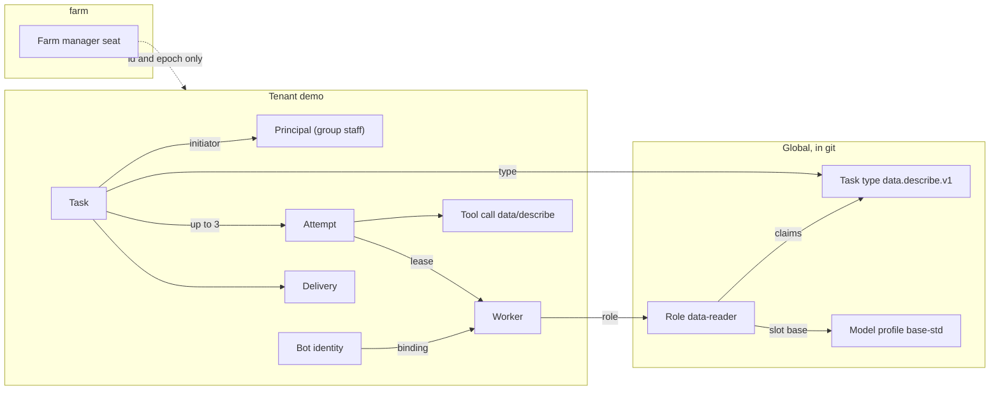

# Object relations

## In short

This page lists the objects of the skeleton and the relations between them with their cardinalities: a task has at most three attempts, a seat has at most one holder, an approval is executed at most once. Almost every rule rests on one of these relations. Every object except the global manifests belongs to exactly one tenant and never changes tenant (TEN-1), so lines to the tenant are left out. The numbers are defaults: a tenant can lower them but not raise them above the farm ceiling. Fields and lifecycles live in the section documents; this page holds only what links objects together.

## How to read

- "A -> B, N : 1": many A have one B. "1 : 0..1": B may be absent. "1 : N (up to 3)": at most three by default.
- "At any moment": the relation changes over time, but never exceeds the number at one time.
- The last column names the rule that checks the relation.
- Origin: "git" is a manifest with human review brought in by `apply`; "command" is a record created through P2; "core" is a working record whose fields only the core writes (IDN-1).

## Objects

| Object | Origin | Owner | Described in |
|---|---|---|---|
| role, role profile, task type, action, plugin, message type, model profile, lens | git or skeleton registry | global | [task-language.md](../task-language.md), [models-and-money.md](../models-and-money.md) |
| incident class | farm git | global | [farm-manager.md](../farm-manager.md) |
| tenant with privacy block and limits | git and core record | the tenant; the service tenant `farm` always exists | [operations.md](../operations.md) |
| group, catalog (with services, monitoring scripts and triggers), route, schedule, channel, sink, bot group, observation series, charter, corpus | git | tenant | [task-language.md](../task-language.md), [permissions.md](../permissions.md) |
| principal, identity, membership, invitation, chat binding, worker, hold | command | tenant; holds of scopes `farm` and `seat` in `farm` | [permissions.md](../permissions.md), [operations.md](../operations.md) |
| commission seat, farm manager seat | charter; the core writes the holder | tenant; the farm manager seat in `farm` | [improvements.md](../improvements.md), [farm-manager.md](../farm-manager.md) |
| activity, task, attempt, lease, tool call, delivery, approval, decision event, message, inbox entry, file, session, memory item, usage line, event, audit record | core | tenant | [tasks-and-delivery.md](../tasks-and-delivery.md) |
| observation point, proposal, review, change trial, attribution, governance case, queue entry | core (points also from `job` code) | tenant | [improvements.md](../improvements.md) |
| bot identity, fact, fact offer | core | tenant; the farm manager seat holder in `farm` | [bots.md](../bots.md) |
| campaign, script run, incident, control operation, finding, model grant, escalation, alarm, erasure request, tombstone | core | tenant; farm-level incidents and alarms in `farm` | [coordination.md](../coordination.md), [farm-manager.md](../farm-manager.md) |

## How it works

### People, permissions and workers

| Relation | Cardinality | Rule |
|---|---|---|
| principal -> identity | 1 : N (0 for `system`) | IDN-4, TEN-4 |
| tenant -> principal `system` | 1 : 1 | PRM-10 |
| principal <-> group (membership) | N : M, same tenant only | TEN-1, PRM-7 |
| membership -> granting principal | N : 1; a privileged group needs the operator and a verification code | PRM-7, PRM-13 |
| worker -> role | N : 1, fixed at `enroll` | TEN-4, DEP-2 |
| worker -> owner | N : 0..1 (a personal assistant) | IDN-5 |
| role -> role profile | N : 1; the profile carries the rank ceiling | PRF-1, GOV-3 |
| role -> task type (`claims`, `may_enqueue`) | N : M | PRF-1, PRM-6 |
| role -> model profile (slots) | N : M, within the tenant's `models_allowed` | GW-7 |
| tenant -> workspace and provider key | 1 : 1 per provider | GW-3 |
| bot group -> worker | N : M, computed by the core; grants nothing | BGR-1, BGR-2 |

### Tasks, attempts and deliveries

| Relation | Cardinality | Rule |
|---|---|---|
| task -> initiator | N : 1, inherited by children | IDN-2 |
| attempt -> initiator set | 1 : N; permissions are intersected with each | IDN-9, MSG-7 |
| task -> parent task | N : 1, depth at most 5 | PRM-6 |
| task -> referenced object | N : M, own tenant only | TEN-7 |
| task -> attempt | 1 : N (up to 3), at most 6 runtime runs | FEN-3 |
| attempt -> lease -> worker | 1 : 1, then N : 1; a stale token gets `fenced` | FEN-1, FEN-2 |
| task -> worker | N : 0..1 at any moment, only through `claim` | DSP-1 |
| attempt -> action request | 1 : N, at most 3 per task | APR-2 |
| approval -> action task | 1 : 0..1 (1 : N items for a campaign) | APR-7 |
| approval -> approver decision | 1 : 0..2; a second one only with `approvals: 2`, from another person | APR-16 |
| decision subject -> decision event | 1 : 0..N, one per decision | APR-11 |
| card or notice kind -> decision registry row | 1 : 1 | APR-12 |
| tool call, delivery -> worker | N : 1, matching the `enroll` record | TEN-3, TEN-3a |
| service or script call -> `service_grant` record | 1 : 0..1; otherwise a card | APR-18, INJ-15 |
| model or tool call -> usage line | 1 : 1 | BUD-3 |
| audit chain -> signed head | 1 : 1 at a moment | AUD-6 |

### Messages and coordination

| Relation | Cardinality | Rule |
|---|---|---|
| message -> inbox entry | 1 : 1 with mode `one`; 1 : N (up to 50) with `all` | MSG-14 |
| attempt -> sent messages | 1 : 0..3, published only on `complete` | MSG-9, MSG-15 |
| inbox entry -> reading attempt | N : 0..1 at any moment, at most 3 handouts | MSG-9 |
| route `on: inbox` -> wake-up task | at most one per window | MSG-16 |
| campaign -> item | 1 : N (up to 100 per tenant) | ORC-5 |
| campaign item -> task | 1 : 1, executed at most once | APR-7 |
| tree root -> tasks | 1 : N (up to 300 per tenant), up to 10 direct children | ORC-8 |
| script run -> script step | 1 : N (up to 10, up to 3 with an action) | SCR-5 |
| script step -> approval | 1 : 0..1; a run's approval does not approve its actions | SCR-7 |

A task is addressed to a role or a bot group, and `claim` picks the worker; there is no "task -> bot" relation (DSP-1).

### Improvements, bots and seats

| Relation | Cardinality | Rule |
|---|---|---|
| proposal -> change | 1 : 1, own tenant only | PRP-3, PRP-8 |
| proposal -> review | 1 : N, one per lens | COM-7 |
| proposal -> change trial | 1 : 0..1; trial -> guards 1 : 1..3 | PRP-21 |
| proposal -> attribution candidate | 1 : N; only a person decides | GOV-13 |
| bot identity -> worker or seat | 1 : 0..1 at any moment, with the binding epoch | IDN-8 |
| worker -> bot identity | 1 : 1 at any moment | IDN-8, IDN-11 |
| record -> acting identity | N : 1, written only by the core | IDN-8 |
| seat -> holder | 1 : 0..1, with the seat epoch | IDN-10 |
| farm -> farm manager seat | 1 : 1; stop reasons 0..3 | MGR-1, GOV-22 |
| identity -> fact space | 1 : 1 per tenant, at most 100 active facts | MEM-6 |
| retired identity -> fact offer -> successor | 1 : 0..1, same tenant only | MEM-7 |
| tenant -> open governance case | 1 : 0..1; case -> leaver 1 : 0..1 after a person's button | GOV-6, GOV-12 |
| identity -> promotion queue entry | 1 : 0..1 | GOV-14 |

### Holds, alarms, incidents and erasure

| Relation | Cardinality | Rule |
|---|---|---|
| hold -> scope; hold -> effects | 1 : 1; 1 : N from closed lists | HLD-1 |
| alarm event -> episode by `alarmkey` | N : 1 | OBS-6 |
| episode change -> E5 delivery | 1 : 1 in `seq` order; no E1 delivery | MON-1, MON-11 |
| monitoring problem -> `ext.monitor.problem.v1` | 1 : 1 per (`eventid`, state) | MON-5 |
| catalog machine -> monitoring host | N : 0..1; never a farm node | MON-6, DEP-11 |
| managed service -> running action | 1 : 0..1 | MON-8 |
| alarm -> incident | N : 0..1, opened only by the core | MGR-8 |
| incident -> involved target | 1 : 0..20 | MGR-7 |
| control operation -> basis | N : 1 (incident, directive, escalation) | MGR-9 |
| reading attempt -> finding | 1 : 0..10 | MGR-25 |
| task -> model grant; attempt -> escalation | 1 : 0..1 each | MGR-17, MGR-5 |
| erasure request -> store outcome | 1 : N; open while any store has not finished | RET-7, RET-4 |
| erased task -> tombstone | 1 : 1; the key stays taken | RET-3 |

### Across the tenant boundary

Nothing crosses the wall except these links (TEN-5):

- global manifests, shared by all tenants and holding no tenant data (TEN-6);
- a farm manager seat attempt in a tenant references the holder identity in `farm` only by id and epoch (`acting_bot`, `bot_epoch`, `seat_epoch`), and nothing is read through it (TEN-1, MGR-3);
- the service principal `seat:farm-manager` acts in each tenant through that tenant's group `farm-manager-ops`, which the tenant admin can narrow (MGR-3), unless the tenant opted out (MGR-42);
- the organization's monitoring system sees the alarms of all tenants with a `tenant` tag, but each tenant has its own E5 adapter and monitoring user (MON-4);
- the operator works with `admin:*` in `farm` through `farmctl` only (PRM-14).

There is no process that serves two tenants, no shared provider key or workspace (GW-3), no file deduplication across tenants, and no fact, message or proposal that moves to another tenant (MEM-7, MSG-4).

## Why it works this way

- A cardinality is something code can check: "at most one holder", "at most three attempts", "one execution per approval". A rule without a relation has nothing to be checked against.
- Only the core writes working records, so the cardinalities do not depend on the honesty of the model: it cannot create a second attempt, approval or seat holder.
- A cross-tenant reference by id and epoch only lets one farm manager work in every tenant without moving data.

## Example on `demo`

A person in `staff` sends a file with `/describe`. The task has one initiator and one type; the core hands it to one `data-reader` worker at a time, and the attempt carries the worker's bot identity and epoch. The attempt's tool call goes to the tenant's own toolhost, and the answer is one delivery to the person's chat. If the attempt fails, a second one gets a new lease number, and the first one's late writes get `fenced`.
