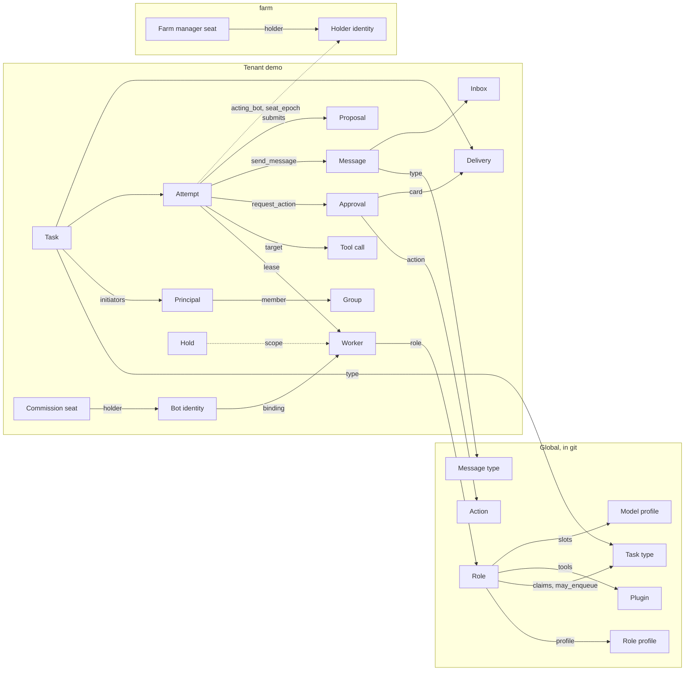

# Object relations

## In short

This document collects the objects of the skeleton and the relations between them with their cardinalities. Almost every rule of the skeleton rests on one of these relations: a task has at most three attempts, a seat has at most one holder, an approval is executed at most once. Every object except the global manifests belongs to exactly one tenant, and the tenant of a record never changes (TEN-1); that is why lines to the tenant are omitted from the tables. Records of two tenants are linked only by a reference to a bot identity or a seat by id and epoch in fields that the core writes, and nothing is read through such a reference (TEN-1). The numbers in the cardinalities are defaults: a tenant can lower them but not raise them above the farm ceiling, and periods that protect people can only be lengthened by configuration. The fields of objects and their lifecycles are described in the section documents; this page holds only what links objects together.

## How to read

- "A -> B, N : 1" means: many A have one B. "1 : 0..1": B may be absent. "1 : N (up to 3)": one A has at most three B by default.
- "At any moment": the relation changes over time, but there are never more than the stated number at the same time.
- The column "What enforces it" names the rule that checks the relation. A relation without a version mark applies from v0.1.
- An object has one of three origins. "git": a manifest with human review, which `apply` brings into the store. "command": a record created by P2 (through `farmctl` or a tenant admin command). "core": a working record whose fields only the core writes (IDN-1).

## Objects

| Object | Origin | Owner | Since | Described in |
|---|---|---|---|---|
| role (`Role`) | git | global | v0.1 | [task-language.md](../task-language.md) |
| role profile | skeleton, `spec/model/role-profiles.yaml` | global | v0.1 | [scripts-and-translator.md](../scripts-and-translator.md) |
| task type (`TaskType`), action (`Action`) | git | global | v0.1 | [task-language.md](../task-language.md), [permissions.md](../permissions.md) |
| plugin and its tools (`ToolPlugin`) | git | global | v0.1 | [extending.md](../extending.md), [security-model.md](../security-model.md) |
| message type (`MessageType`) | git | global | v0.1 (D-71) | [messaging.md](../messaging.md) |
| model profile (`ModelProfile`) | git | global | v0.1 | [models-and-money.md](../models-and-money.md) |
| lens | skeleton, `spec/model/lenses.yaml` | global | v0.1 (D-71) | [improvements.md](../improvements.md) |
| incident class (`IncidentClass`) | farm git | global | v0.1 | [farm-manager.md](../farm-manager.md) |
| tenant (`Tenant`) with privacy block and limits | git and core record | the tenant itself; the service tenant `farm` always exists | v0.1 | [operations.md](../operations.md), [privacy.md](../privacy.md) |
| group (`Group`) | git | tenant | v0.1 | [permissions.md](../permissions.md) |
| resource catalog, route, schedule | git | tenant | v0.1 | [task-language.md](../task-language.md) |
| managed service (`Catalog.spec.hosts[].services[]`, with `health` for the check after an action) | git, catalog | tenant | v0.1 | [task-language.md](../task-language.md), [monitoring.md](../monitoring.md) |
| allowed scripts and triggers of the monitoring system (`hosts[].monitor_scripts_allowed`, `monitor_triggers`), the flag `hosts[].maintenance_hold` | git, catalog | tenant | v0.1 | [task-language.md](../task-language.md), [monitoring.md](../monitoring.md) |
| backup report (`backup.report`) | external backup process through P2 | `farm` | v0.1 | [operations.md](../operations.md) |
| channel, sink | git | tenant | v0.1 | [tasks-and-delivery.md](../tasks-and-delivery.md) |
| bot group (`BotGroup`), dispatch rule | git | tenant | v0.1 (D-71) | [messaging.md](../messaging.md), [coordination.md](../coordination.md) |
| observation series (`ObservationSeries`) | git | tenant | v0.1 (D-71) | [improvements.md](../improvements.md) |
| charter (`governance.yaml`) | git | tenant | v0.1 | [commission.md](../commission.md) |
| knowledge corpus | git, catalog resource | tenant | v0.2 | [capabilities.md](../capabilities.md) |
| principal (`Principal`), identity, membership, invitation | command | tenant | v0.1 | [permissions.md](../permissions.md) |
| chat binding (`ChatBinding`; the channel secret for P2 is held by the driver, not by the binding, D-87 (3)) | operator command P2 `chat.bind` | tenant | v0.1 | [permissions.md](../permissions.md) |
| worker | command P2 `worker.enroll` | tenant | v0.1 | [worker.md](../../spec/lifecycles/worker.md) |
| hold (`Hold`) | command P2 `hold.set`, auto-stop, control operation | tenant of the scope; holds of the scopes `farm` and `seat` in `farm` | v0.1 | [operations.md](../operations.md) |
| commission seat | charter; the core writes the holder | tenant of the commission | v0.1 | [commission.md](../commission.md) |
| farm manager seat | charter of `farm`; the core writes the holder | `farm` | v0.1 | [farm-manager.md](../farm-manager.md) |
| activity (`Activity`) | core, from a channel | tenant | v0.1 | [tasks-and-delivery.md](../tasks-and-delivery.md) |
| task, attempt, lease, tool call, delivery | core | tenant | v0.1 | [tasks-and-delivery.md](../tasks-and-delivery.md) |
| approval, decision event | core | tenant | v0.1 | [permissions.md](../permissions.md) |
| message, inbox entry | core | tenant | v0.1 (D-71) | [messaging.md](../messaging.md) |
| file, artifact | core | tenant | v0.1 | [capabilities.md](../capabilities.md) |
| session, memory item | core | tenant | v0.1 | [bots.md](../bots.md) |
| usage line, event, audit record | core | tenant | v0.1 | [models-and-money.md](../models-and-money.md), [security-model.md](../security-model.md) |
| observation series point | code: the core or a `job` worker | tenant | v0.1 (D-71) | [improvements.md](../improvements.md) |
| proposal, review, change trial | core | tenant | v0.1 (D-71) | [improvements.md](../improvements.md) |
| alarm | core | tenant; alarms of the farm itself in `farm` | v0.1 | [operations.md](../operations.md) |
| erasure request, tombstone | core | tenant | v0.1 | [operations.md](../operations.md) |
| bot identity (`Bot`) | core | tenant; the farm manager seat holder in `farm` | v0.1 | [bots.md](../bots.md) |
| fact, fact offer (`FactOffer`) | core | tenant | v0.1 | [bots.md](../bots.md) |
| campaign and its item | core | tenant | v0.1 | [coordination.md](../coordination.md) |
| script run and script step | core | tenant | v0.1 | [scripts-and-translator.md](../scripts-and-translator.md) |
| incident, control operation, finding | core | tenant; a farm incident in `farm` | v0.1 | [farm-manager.md](../farm-manager.md) |
| attribution of an incident to a change | core or human; a human decides; after the incident is dismissed as false it becomes disputed (`disputed`, D-79) | tenant | v0.2 (ban for bots since v0.1) | [commission.md](../commission.md) |
| governance case, queue entry | core | tenant of the commission | v0.2 | [commission.md](../commission.md) |
| model grant (`ModelGrant`), escalation (`Escalation`) | core | tenant | v0.2 | [farm-manager.md](../farm-manager.md) |

## Diagram of the main relations

The diagram shows one tenant `demo` and the service tenant `farm`. The dashed arrow from `demo` to `farm` is a reference by id and epoch: the core writes it into the attempt, and there is nothing to read through it.

## People, permissions and workers

| Relation | Cardinality | What enforces it |
|---|---|---|
| tenant -> principal | 1 : N | a principal lives in one tenant, and its identity is unique in that tenant (IDN-4) |
| principal -> identity | 1 : N (0 for `system`) | a channel looks up an identity only among the principals of its own tenant (TEN-4) |
| tenant -> principal `system` | 1 : 1 | every tenant has exactly one service principal `system`; its group `system-ops` lists only the types of its schedules and routes, and it has no permissions for decisions (PRM-10) |
| principal <-> group (membership) | N : M | only groups of the same tenant; a membership has a term and a state (TEN-1) |
| membership -> granting principal | N : 1, and 0..1 requesting one | only what the granter has can be granted (PRM-7); only the operator grants a privileged group, the membership is `pending` until the verification code is checked, and a production tenant needs a requester (`--requested-by`) (PRM-13) |
| principal -> invitation | 1 : N as creator | an invitation is single-use and has an expiry; when it is used, the core checks the creator again (PRM-7) |
| chat binding -> channel | N : 1 | a group chat works only after binding, and the binding has a class ceiling (DLV-7) |
| worker -> role | N : 1 | `enroll` fixes the tenant, the role, the kind, the labels, for a toolhost the plugins, placement and machine; `hello` can only narrow the labels (TEN-4, DEP-2) |
| worker -> owner | N : 0..1 | a worker with an owner (a personal assistant) takes only tasks of its owner (IDN-5) |
| role -> role profile | N : 1 | the profile only narrows the role and carries the model rank ceiling `max_rank` (PRF-1, GOV-3) |
| role -> task type (`claims`, `may_enqueue`) | N : M | a role takes only the types of its `claims` that the profile allows; it enqueues a child only from `may_enqueue` (PRF-1, PRM-6) |
| role -> plugin (`tools`) | N : M | tools have only closed kinds of parameters (INJ-1) |
| tool parameter -> catalog resource | N : M | only closed kinds; a resource is declared in the catalog of exactly one tenant (INJ-1, TEN-4) |
| role -> model profile (through the slots `base`, `analysis`) | N : M | the rank of the model profile is not above the ceiling of the role profile (GOV-3) |
| tenant -> model profile (`models_allowed`) | N : M | P4 allows a model only by the role's slot and the tenant's list (GW-7) |
| tenant -> workspace and provider key | 1 : 1 per provider | a call for a tenant's task goes only with that tenant's key and in its workspace (GW-3, TEN-5) |
| bot group -> worker | N : M, the core computes the membership | a selector by roles and labels; a bot group grants no permissions (BGR-1, BGR-2) |

## Tasks, attempts and deliveries

| Relation | Cardinality | What enforces it |
|---|---|---|
| task -> task type | N : 1 | the type for a person's message is chosen by the channel code, not by the model (IDN-6) |
| task -> initiator | N : 1 | the initiator is a verified identity, and children inherit it (IDN-2) |
| attempt -> initiator set | 1 : N | inbox entries that were read add their `origininitiators`; the attempt permissions are the permissions of the worker's role intersected with the permissions of the groups of every initiator (MSG-7, IDN-9) |
| task -> task (`parent`) | N : 1 | depth at most 5, permissions no wider, the mark and `untrusted_seen` are inherited (PRM-6, INJ-13) |
| task -> object (`refs`, `file_ref`) | N : M | only objects of its own tenant; a foreign object and a nonexistent one give the same `rejected(ref_invalid)` (TEN-7) |
| task -> conversation (session) | N : 0..1 | the core computes the session key (MEM-1); since v0.2 the order of the tasks of one conversation (MEM-5) |
| task -> attempt | 1 : N (up to 3) | at most 3 attempts and 6 runtime runs `max_runs`; a non-idempotent action has one attempt (FEN-3, APR-7) |
| attempt -> lease -> worker | 1 : 1, then N : 1 | the lease number grows, and the token carries the store epoch; a stale token gets `fenced` (FEN-1, FEN-2) |
| task -> worker | N : 0..1 at any moment | work only through `claim` and only of its own tenant (DSP-1, TEN-3) |
| attempt -> tool call, approval, child task, message | 1 : N | every call carries the attempt's token (FEN-2); at most 3 action requests per task (APR-2) and 3 messages per attempt (MSG-15) |
| tool call -> toolhost | N : 1 | `target` matches the toolhost record; the core takes the target machine from the tool's `target_from` argument, and with `target: any` the target has no machine; a call not taken within `start_by` (30 s) ends with `error(no_executor)` (TEN-3a, CNT-4) |
| delivery -> channel, sink or monitoring adapter | N : 1 | the delivery's `target` (kind and name) matches the process's `enroll` record (TEN-3) |
| role -> managed service (`service_control`) | N : M; `["*"]` means all services in the catalog of its own tenant | people grant the permission in the role manifest; monitoring system scripts by a list of names `monitor_scripts: [<name>...]` from `monitor_scripts_allowed` of the catalog, `["*"]` means all (MON-8, MON-10), v0.1 |
| human -> managed service (`service.control:<service>`) | N : M | the command `/service <verb> <service>` runs without a card as a `service_grant` record with the human as author, with the same guards (D-68), v0.1 |
| call `service/control` or `monitor/script_run` -> audit record `service_grant` | 1 : 0..1 | without a card only from the role's allowed list and without `untrusted_seen` in the task, otherwise an approval and a card instead of the record (APR-18, INJ-15); one execution per record number, v0.1 |
| approval -> source task | N : 1 | an action request is accepted only by the permissions of the role and of every initiator of the attempt (APR-2) |
| approval -> task `action.<a>` | 1 : 0..1; for a campaign 1 : N items | an approval is executed at most once, by exactly one write call (APR-7, IDM-2) |
| approval -> approver vote | 1 : 0..2 | a second vote only with `approvals: 2`, from another person (APR-16) |
| decision subject -> card delivery | 1 : N | one per recipient; a decision is accepted only from the delivery's chat (APR-4) |
| decision subject -> decision event | 1 : 0..N | one event per decision, including through P2 (APR-11); more than one with two approvers (APR-16) and when the answer changes by `attribution` while the attribution window is open (APR-4) |
| (card delivery, person) -> opening "Details" | 1 : 0..1 | since v0.2 three decisions without opening are rejected (APR-14) |
| card or notice kind -> decision registry row | 1 : 1 | a kind without a row fails the skeleton CI and is not delivered (APR-12) |
| task, approval -> delivery | 1 : N | the address only from a closed list, the mark against the ceiling and the chat membership (DLV-6, DLV-7) |
| schedule -> task | 1 : N | the slot key, the group `system-ops` (IDM-2, PRM-10) |
| route -> task | 1 : N | the event key; `system` tasks only from the group `system-ops` (IDM-2, PRM-10) |
| file -> producer (task or principal) | N : 1 | files are not deduplicated across tenants (TEN-5); `file_ref` carries 128 random bits (TEN-7) |
| model or tool call -> usage line | 1 : 1 | the line carries the task, the principal, the chat, the role, the bot identity and the budget line (BUD-3) |
| audit record -> any object | N : 1 | append only, metadata only (AUD-2, AUD-3) |
| audit chain -> head `(epoch, seq, hash, key_id, sig)` | 1 : 1 at a moment | the core signs it with its key; `audit.verify` checks the signature and the monotonicity of `seq` against the witness history (AUD-6, MON-3) |

## Messages and work distribution

| Relation | Cardinality | What enforces it |
|---|---|---|
| message -> message type | N : 1 | the type sets the genus (`report` or `state`) and the delivery mode (MSG-14) |
| message -> inbox entry | 1 : 1 with `one`; 1 : N with `all` (up to 50 copies) | an `all` copy goes only to roles with a worker inbox (MSG-14) |
| tenant -> inbox | 1 : N | a role inbox per pair (tenant, role), a group inbox per (tenant, bot group), a worker inbox per (tenant, worker) and only for roles with `instance_inbox: true` (MSG-14) |
| inbox -> role, bot group or worker | 1 : 1 | inboxes arise from the manifests of roles and groups; only the core writes the `worker:` address (MSG-4) |
| attempt -> sent entries | 1 : 0..3 | a message is published only in the transaction of a successful `complete` (MSG-9, MSG-15) |
| route `on: inbox` -> wake-up task | 1 : N, at most one per window | the core enqueues the wake-up task as `system` (MSG-16) |
| route `on: task_done` -> auto-report | 0..1 per task | the core publishes the auto-report in the transaction of the task's terminal transition (MSG-16) |
| task -> bot group (`to.group`) | N : 0..1 | a group only narrows dispatch and grants no permissions (BGR-2) |
| tenant dispatch rule -> task type | 1 : N by name or prefix | a type gets the first matching rule; a rule only narrows (DSP-3) |
| inbox entry -> reading attempt | N : 0..1 at any moment | acknowledgement only together with `complete`, at most 3 handouts (MSG-9) |
| `state` entry -> (inbox, sending worker, type) | 1 : 1 | a new value replaces the previous one; only worker code sends it (STA-1) |
| campaign -> item | 1 : N (up to 100 for a tenant, up to 500 for the farm, an action has its own ceiling) | the size is no wider than the ceilings of the action, the role and the tenant (ORC-5) |
| campaign item -> task | 1 : 1 | every item is executed at most once (APR-7) |
| campaign -> approval | 1 : 0..1 | one approval for an exact plan snapshot (APR-7) |
| campaign -> continuation | 1 : 0..1 | the continuation is part of the tree reserve (ORC-8) |
| "retry failed" campaign -> original campaign | 1 : 1 by `refs` | a retry creates a new campaign with a new approval (ORC-1) |
| tree root -> tasks of the tree | 1 : N (up to 1000 for the farm, up to 300 for a tenant); up to 10 direct children | the tree limits and the reserve as a whole (ORC-8) |
| script run -> script step | 1 : N (up to 10 for a tenant, up to 20 for the farm; up to 3 with an action) | draft acceptance by the core (SCR-5) |
| script step -> task, campaign, approval | 1 : 0..1 of each | the approval of a run does not approve actions: a step with an action gets its own approval (SCR-7) |
| script run -> initiator | N : 1, only a `human` principal | a run of a model draft only after the initiator's button (SCR-6) |
| proposal -> script run | 1 : 0..1 | a run is created only by the "Accept" button on a change of kind `script` (PRP-4) |

Distribution (who gets which task) is set by the dispatch rules and bot groups, not by a "task -> bot" relation: a task is addressed to a role or a bot group, and `claim` selects the specific worker (DSP-1).

## Improvements

| Relation | Cardinality | What enforces it |
|---|---|---|
| observation series -> tenant | N : 1, exactly one | a value of closed kind (OBV-2); only code writes points (OBV-1) |
| core series -> definition of "better" | 1 : 1 | the skeleton sets the registry of core series (OBV-6) |
| proposal -> author (bot identity) | N : 1 | the core writes `acting_bot` and the epoch (PRP-14); since v0.2 a bot has at most one open proposal (PRP-16) |
| proposal -> change | 1 : 1 | exactly one change from the allowlist (PRP-3), targets only of its own tenant (PRP-8) |
| proposal -> review | 1 : N, at most one per lens | a lens has one executor source at any moment (COM-7) |
| proposal -> change trial | 1 : 0..1 | the record is created on "Accept" of any kind except `none` (PRP-21) |
| trial -> metric; trial -> guards | 1 : 1; 1 : 1..3 | a metric only from series with an `outcome` block (PRP-21, OBV-6) |
| proposal -> commit | 1 : 0..1 (one commit can close a batch of proposals) | "done" only by a verified link (PRP-19) |
| proposal -> incident attribution | 1 : N | a candidate is created by code or by a human, and only a human decides (GOV-13); candidates since v0.2, the ban on bots touching attributions since v0.1; dismissing an incident as false (`incident.dismiss {reason_code, details}`) does not erase a "Yes" answer: the attribution becomes `disputed`, the author of the "Yes" gets a card and confirms or withdraws the answer, silence for 7 days withdraws it, and while the dispute is open there is no promotion trigger (D-79, GOV-13, GOV-30) |

## Bots, seats and the commission

| Relation | Cardinality | What enforces it |
|---|---|---|
| bot identity -> worker or seat | 1 : 0..1 at any moment, with the binding epoch | only the core issues the id and never reuses it (IDN-8), v0.1 |
| worker -> bot identity | 1 : 1 at any moment | the identity outlives a change of worker; when the worker is retired, it is `unbound` (IDN-8, IDN-11) |
| record (attempt, usage, proposal, review, fact, audit) -> identity | N : 1 | only the core writes the fields `acting_bot` and `bot_epoch` (IDN-8) |
| identity -> role | N : 1 | an identity and a position grant no permissions (IDN-9) |
| identity -> persona | N : 1, a file in git by hash | (GOV-4) |
| tenant -> charter | 1 : 1 | only the charter declares commission seats (GOV-33), v0.1 |
| tenant -> commission | 1 : 1 | every tenant has its own commission; the charter declares the seats and their lenses (GOV-33) |
| commission seat -> lens | N : 1 | (GOV-33, COM-8) |
| seat -> holder (identity) | 1 : 0..1, with the seat epoch | only the core writes the holder, in one transaction (IDN-10) |
| farm -> farm manager seat | 1 : 1, in `farm` | one seat, one holder, one epoch (MGR-1) |
| farm manager seat -> stop reasons | 1 : 0..3 (`human`, `no_control`, `incident`) | the seat is in `held` only while the set is empty (GOV-22, MGR-14, MGR-15) |
| identity -> fact space | 1 : 1 in a tenant; the farm manager seat holder has a space in every tenant | facts of a closed schema, at most 100 active per space and 3 from one attempt (MEM-6, MGR-27) |
| departing identity -> fact offer | 1 : 0..1; the manager has an offer for each tenant | facts are offered only to the successor and only in the same tenant (MEM-7) |
| fact offer -> successor | 1 : 0..1 | the newcomer chooses itself, at most 50 facts (MEM-7) |
| tenant -> open governance case | 1 : 0..1 | only the core opens a case (GOV-6), v0.2 |
| case -> leaver | 1 : 0..1 (in the mode `removal` exactly one seat of L after the person's button) | code proposes it or a person chooses it (GOV-12, GOV-43) |
| identity -> queue entry | 1 : 0..1 | one entry per bot, without expiry (GOV-14) |
| departed identity -> tombstone | 1 : 1 | the number, the role, the time, the trigger and the successor's number remain after erasure (IDN-11, MEM-4) |

## Holds, alarms, incidents and control

| Relation | Cardinality | What enforces it |
|---|---|---|
| hold -> scope | 1 : 1 | scopes from a closed list: `farm`, `tenant`, `role`, `tasktype`, `worker`, `plugin`, `action`, `channel`, `host`, `resource`, `bot_group`, `bot`, `seat` (v0.1); `schedule`, `governance` (v0.2) (HLD-1) |
| hold -> effect | 1 : N | effects from a closed list; a hold only narrows (HLD-1, HLD-2) |
| alarm event -> alarm episode by the key `alarmkey` (alarm name and subject) | N : 1 | repeats with the same key do not multiply exports; only code produces an alarm (OBS-6) |
| change of an alarm episode (`firing`, `resolved`) -> E5 delivery | 1 : 1, in `seq` order; a repeated `firing` only increments `repeat_count` | alarms reach people only through the monitoring system, and an alarm has no E1 deliveries; the delivery is retried while the episode is open (MON-1, MON-11) |
| monitoring system problem -> event `ext.monitor.problem.v1` | 1 : 1 per (`eventid`, state) | only nodes linked to a catalog resource; the class and item from the `monitor_triggers` row of the catalog by `triggerid`, and a trigger outside the catalog gives the class `unknown`; the key `system:ingress:monitor:<eventid>:<state>` (MON-5), v0.1 |
| event `ext.monitor.problem.v1` -> farm alarm | 1 : 0..1 | a `job` raises the alarm after a recheck by code (MON-5, INJ-7), v0.1 |
| event `ext.monitor.problem.v1` -> route task | 1 : N | for a trigger from `monitor_triggers` of the catalog without `untrusted_seen`, the task source is `monitor`; for a trigger outside the catalog with the flag (INJ-13, D-82), v0.1 |
| catalog machine resource -> monitoring system node (`monitor_host`) | N : 0..1 | a farm node (`core1`) cannot be a catalog resource: `apply` rejects it (MON-5, MON-6, DEP-11), v0.1 |
| catalog machine resource -> maintenance window | 1 : N | a hold with the effect `pause_action` (pending approvals are paused); `no_action` only with `maintenance_hold: true` (MON-9), v0.2 |
| catalog machine resource -> managed service | 1 : N | `name` is unique in the tenant, `control` from `start`, `stop`, `restart`; services of the core and of farm nodes fail the lint (MON-8), v0.1 |
| managed service -> action in progress | 1 : 0..1 | one operation per service at a time (`exclusive: resource`); at most 6 actions per hour per service and 30 per tenant (MON-8), v0.1 |
| catalog node -> monitoring system script (`monitor_scripts_allowed`) | 1 : N | the name for the model comes from the catalog; the core checks `scriptid` against the latest list of the E5 adapter, and the list arrives only when its hash changes; on farm nodes and on nodes of other tenants the adapter user has no scripts (MON-10, MON-4), v0.1 |
| action with a service or script -> code note `service_control_done` | 1 : 0..1 | on the node's open problem, without model text, outside the bot note limit (MON-8), v0.1 |
| task result -> problem note | 1 : 0..1; at most 10 per hour per tenant | only a role with `outputs: [monitor_note]` (MON-7), v0.2 |
| maintenance window -> hold | 1 : 1 per host and active period | author `contain_auto`, source `system:monitor`, `until` from the latest poll, moved forward and never back (MON-9), v0.2 |
| incident class -> incident | 1 : N | classes only from the farm git with human review (MGR-7), v0.1 |
| alarm -> incident | N : 0..1 | only the core opens an incident, from an alarm and a class (MGR-8) |
| incident -> involved target | 1 : 0..20 | the class rules name the involved parties (MGR-7) |
| incident -> control operation | 1 : N | (MGR-9) |
| control operation -> basis | N : 1 (incident, directive, escalation) | the operation carries the seat epoch; a stale one gets `fenced` (MGR-9, IDN-10) |
| control operation -> hold, card | 1 : 0..1 of each | every operation reaches people at once (MGR-13) |
| tenant -> farm manager (`Tenant.spec.farm_manager`) | 1 : 0..1 | `enabled: true` by default; with `enabled: false` the manager does not read the tenant's data and does not run the review and the lens, and the tenant's incidents go only to its admins (D-77, TEN-5, MGR-42), v0.1 |
| seat task -> tenant | N : 1 | one seat attempt sees exactly one tenant (MGR-24) |
| reading attempt -> finding | 1 : 0..10 | the reading bot submits only findings of a closed schema (MGR-25) |
| task -> model grant | 1 : 0..1 | a grant with a ceiling as a euro amount and an expiry (MGR-17, MGR-18), v0.2 |
| attempt -> escalation | 1 : 0..1 | at most one escalation per attempt (MGR-5), v0.2 |

## Retention and erasure

| Relation | Cardinality | What enforces it |
|---|---|---|
| erasure request -> scope | 1 : 1: `(tenant)`, `(tenant, subject)` or a list of object ids | early erasure only through an erasure request (RET-7) |
| erasure request -> store outcome | 1 : N | the `erasure` loop collects the outcome of every store (`done`, `failed`, `not_applicable`); while there is a `failed`, the request stays open (RET-7, RET-4) |
| erased task -> tombstone | 1 : 1 | the idempotency key stays taken, and a repeat gets `gone` (RET-3) |
| principal -> subject request (erase, export) | 1 : N | an erasure request from a subject creates an erasure request ([privacy.md](../privacy.md)) |
| runtime with `runtime_internal` -> runtime profile | 1 : N, a profile per (tenant, role, principal) or per chat | the profile is cleaned at its expiry and by an erasure request through the adapter; a principal's rows are found with the `match` operation (RT-1, RT-2, RT-5) |
| erasure request by match -> store with `match` | 1 : N | E2, E4 and E5 since v0.1 (D-76), E1 since v0.2 (RET-11); a store without `match` is `failed`, and a channel without a cache answers `not_applicable` (RET-7, SEC-11) |
| group chat session -> principals of the conversation | 1 : N in the key | the key includes the principals who wrote, so `(tenant, subject)` finds group sessions (MEM-1) |
| data export -> sink | N : 1 | only a sink with `export_only` (a single recipient, encryption) (LCY-2, SEC-10), v0.2 |

## Across the tenant boundary

The tenant boundary is a wall: data of one tenant never reaches another, neither in records nor in a model context (TEN-5). Below is everything that links records of different tenants; there is nothing else.

| What | How it is linked | What enforces it |
|---|---|---|
| global manifests (role, task type, plugin, action, message type, incident class) | shared by all tenants, without tenant data | (TEN-6) |
| farm manager seat attempt in a tenant -> holder identity in `farm` | only the id and the epoch in the fields `acting_bot`, `bot_epoch`, `seat_epoch` | (TEN-1, MGR-3) |
| service principal `seat:farm-manager` -> group `farm-manager-ops` in every tenant | the tenant's consent: its admin narrows the group's permissions | (MGR-3) |
| tenant opt-out of the farm manager (`farm_manager.enabled: false`) | the manager does not read records of this tenant, does not run the review and the lens for it and does not receive its incidents | (D-77, TEN-5, MGR-42) |
| farm manager seat -> tenant commissions | the seat's advisory lens review in each commission is run by a worker of that tenant's reviewer role on the `seat` slot | (GOV-25, IDN-12), v0.2 |
| alarm about a missing manager | other tenants get only the fact itself, without details | (MGR-2) |
| the organization's monitoring system | one per farm; it sees the alarms of all tenants with the `tenant` tag, only numbers, `enum` values and catalog ids, and bot notes of class no higher than `summary` after redaction (recipient `monitoring` in the privacy block); every tenant has its own E5 adapter with its own monitoring system user, which runs scripts only on the catalog nodes of its own tenant, and the `monitor` plugin reads only the catalog nodes of its own tenant | (MON-1, MON-4, MON-6, MON-10, TEN-4, TEN-5) |
| farm operator | a person with `admin:*` permissions in the service tenant `farm`; works with the core only through `farmctl` with their own P2 credentials | (PRM-14) |

What does not exist: a process that serves two tenants (TEN-4); a provider key or workspace shared by two tenants (GW-3); file deduplication across tenants (TEN-5); facts, messages and proposals that move to another tenant (MEM-7, MSG-4).

## What is in which version

| Version | What appears |
|---|---|
| v0.1 | Relations of people, permissions, workers, tasks, attempts, calls, approvals and deliveries; holds of five scopes; erasure requests and tombstones, erasure at a person's request through port operations (D-76); the fields `acting_bot` and `bot_epoch` in the schemas, still empty; messages, inboxes and bot groups; observation series, proposals, reviews by the `reviewer` role and the trial record with the "before" numbers (D-71); the tenant opt-out of the farm manager and seat pauses by tenant (D-77, MGR-14); bot identities and their binding to workers and seats; the charter, commission seats with lenses and the farm manager seat; facts and the fact offer to a successor; campaigns and script runs; incidents, control operations and findings; managed services, the role's permission for them and `service_grant` records; the remaining hold scopes except `schedule` and `governance` |
| v0.2 | Governance cases and the queue; the advisory lens of the farm manager seat in commissions; model grants and escalations; one open proposal per bot; the hold scopes `schedule` and `governance`; attributions of incidents to changes; knowledge corpora |

## Why it works this way

- Relations with cardinalities are checked by code: "at most one holder", "at most three attempts", "one execution per approval". A rule without a relation has nothing to be checked against.
- A reference across the tenant boundary only by id and epoch lets one farm manager work in all tenants without moving data: there is nothing to read through such a reference.
- Only the core writes working records, so the cardinalities do not depend on the honesty of the model: the model cannot create a second attempt, a second approval or a second seat holder.
