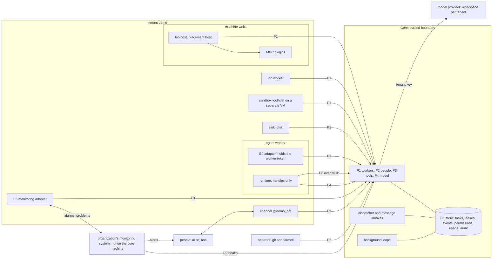

# botaru overview

## In short

botaru is a skeleton of a bot farm for work tasks: concepts, lifecycles, boundary contracts (ports) and the rules that any implementation must keep. Bots work on the farm for several tenants; people talk to them through communication channels, and external programs enqueue tasks with their own key (D-01, D-47). The farm core makes all decisions about permissions, money, addresses and records; the model only proposes, and its text never becomes a command. Anything new is added by a manifest in git or by a port implementation, without editing the core (D-02). This document shows the farm on one screen, follows one message from start to finish and explains where to read further.

## What the skeleton is and what it is not

The skeleton is text and data: the model in words, port sheets, schemas, lifecycles, a rule registry with checks, fixtures, examples for a sample tenant `demo`, the eval case format and the deployment topology. The skeleton need not build by itself: its only executable code is in `ci/`, where linters check consistency (schemas are valid, links are intact, every rule has a check, only additions inside a version, publishing is safe).

The reference implementation is written in Go in the same repository but outside the skeleton, in `impl/` (D-91, D-92), and is the repository's other executable code. It writes the code of the core and `farmctl`, the black-box runner, channel adapters, its own agent runtime (D-93) and the SQL binding of the store, adds port implementations, drivers and manifests, does not edit skeleton files and passes the `conformance/` suite. Other implementations are possible: anything that passes the suite is an implementation.

The skeleton is public, so it contains no secrets and nothing tied to a specific organization: only the tenants `demo` and `demo2`, the people `alice`, `bob`, `carol`, `erin`, the bot `@demo_bot`, the domains `example.org`, addresses from documentation ranges and the sample time zone `Europe/Berlin` where something other than `UTC` is needed. In core records a person is recorded by the opaque principal id `human:p_<ULID>`; people's names appear only in manifests, examples and fixtures (D-85).

## The farm on one screen

The arrows of workers and the runtime point to the core: work is pulled, and a worker takes it itself. The core reaches outside only to the model provider, through P4. The organization's monitoring system watches machines, services and disks, and it also delivers alarms to people (D-59, D-62): the farm hands it its alarms through the E5 adapter, and the monitoring system checks core liveness itself by polling P2 `health` from a machine other than the core machine (D-60). Bots with the role's permission can start, stop and restart the services that the tenant catalog declared manageable by themselves: through an OS mechanism on the machine or a monitoring system script (D-67).

**Who is who.**

| Who | What it is | Example |
|---|---|---|
| Core | The farm code: the core process, background loops, the P3 and P4 gateways, the store logic. The only place where decisions are made | one per farm |
| Tenant | Whose data and whose money: a wall that nothing crosses | `demo`, `demo2` |
| Service tenant `farm` | Holds only what belongs to the farm as a whole: the farm manager seat registry, operator permissions and stops of the `farm` and `seat` scopes; there are no model calls for management in it | `farm` |
| Principal | The one on whose behalf work runs: a person (`human`), an external program with its own key (`service`), the farm itself (`system`) | `alice`, `bob` |
| Channel | A worker of kind `channel`: checks who is writing and delivers answers and cards | `@demo_bot` |
| Worker | A process that takes work through P1 `claim`: an agent, a pipeline (`job`), a toolhost, a channel, a sink, a monitoring adapter (`monitor`) | agent worker of role `ops-reader` |
| Monitoring system | The organization's external system (the reference binding is in the E5 sheet): it watches machines and services, wakes people, handles "Acknowledged", escalation and on-call, and holds scripts; the farm hands it its alarms and the signed audit head, receives from it problems on catalog machines and, with the role's permission, runs its scripts on these machines; the model sees script names and trigger classes only from the tenant catalog (D-59, D-62, D-67, D-69) | the problem "disk is running out" on `db1`, a catalog machine of `demo`; the core lives on `core1`, a farm machine that is not in the tenant catalog |
| Bot | An identity with a number, a role, a persona and memory; it works on workers and outlives their replacement | bot of role `ops-reader` in `demo` |
| Role and role profile | A role sets the bot's task types, tools, models and permissions; a role profile sets what a bot of this role can be at all | role `ops-reader`, profile `worker` |
| Toolhost and plugin | The executor of MCP plugins on an observed machine or in a sandbox | toolhost on `web1` with the plugin `logs` |
| Operator | A person with `admin:*` rights in the service tenant `farm` who works with the core only through `farmctl` with their own P2 credentials and changes the farm through git; operator operations are the closed list PRM-14 (for example the farm layout, tenants from git, workers, chat bindings, privileged permissions, seats, stops of `farm` and `seat`, dead work redrive) | farm operator |
| Commission | The tenant's reviewer bots that evaluate bot proposals through lenses; each tenant has its own (D-23) | commission of `demo` |
| Farm manager | One bot per farm in a seat that a person appoints, always with a new bot (D-33); it prevents critical incidents with operations from a closed list | seat `farm-manager` |

**Role profiles.** Role profiles are a closed list of what kinds of bots exist at all; every profile has its own model rank ceiling and its own set of built-in tools. Functionaries are bots of functional roles: worker, manager, reporter and aggregator (D-22).

| Profile | Who | What it does | Since |
|---|---|---|---|
| `worker` | working bot | work by the task types of its role; analysis of its own series and improvement proposals | v0.1 |
| `manager` | manager | splits work into child tasks for groups of executors and proposes campaigns; does not get the executors' permissions | v0.1 |
| `reporter` | reporter | only reports to people: summaries and cards chosen by code; no plugins, no enqueueing of tasks, no sending of messages and no memory | v0.1 |
| `reviewer` | commission reviewer | reviews a proposal through its lens (security, operations, cost, value); does not see the author or other scores | v0.1 |
| `aggregator` | aggregator | reads series rollups and closed fields of reports and proposals of its tenant, looks for improvements one level up | v0.1 |
| `translator` | translator | writes a script draft from a person's text; nothing else | v0.1 |
| `farm-manager` | farm manager | control operations from a closed list, starting, stopping and restarting catalog services and monitoring system scripts in the tenants where it works, requests to people by card; since v0.2 decisions on granting a strong model | v0.1 |
| `farm-manager-reader` | farm manager's reading bot | reads the logs, results and files of the tenant's tasks and hands in findings in a closed form; cannot act (D-30) | v0.1 |

A person's personal assistant is a worker with an owner: it takes only the owner's tasks from a private chat (IDN-5). It is not a functionary and does not enter the commission (D-07, D-22).

**Tenants and `farm`.** Every record belongs to exactly one tenant (TEN-1), the core takes the tenant and the principal from the credentials (TEN-2), every worker process serves one tenant (TEN-4), and data and model context are not mixed (TEN-5). Every tenant has its own workspace and key at the model provider with its own ceilings (D-42). There is no main tenant. The service tenant `farm` holds the farm manager seat registry and the holder's identity as numbers and codes; the farm manager's work runs in the tenants, with their keys and at their expense (MGR-3, MGR-24). Details in `docs/architecture.md`.

**The improvement cycle** is the most important part of the farm (D-16); in v0.1 it comes after the core and the first bot (D-71). A functionary notices from numbers that only code writes (OBV-1) that something can be improved: the analysis runs on a separate model from the tenant's budget line and no more often than allowed (INS-4). It hands in a proposal with exactly one change from the allowed list (PRP-3). Code checks the form, evidence, duplicates, feasibility and price; the tenant's commission evaluates the proposal through lenses without seeing the author, code computes the outcome, and without the scores of the security and operations lenses the proposal waits (COM-4). What is recommended reaches people in the weekly digest through the reporter (DIG-1), and only a person presses "Accept" (PRP-4). What was accepted is carried out by the ordinary path, the core writes a change trial record (metric, value before, guards), and for exactly 14 days the change trial shows whether the metric improved; a confirmed degradation removes the credit (D-37). Since v0.2 a functionary author whose promotion probation (`probation`, 14 days from realization) passed without a measured degradation and without an attributed incident joins the queue for the commission (D-24), and the commission frees a seat for it with a "who leaves" vote (D-25); a change whose promotion probation ended before the v0.2 rules gives no trigger. On this path bots only propose, evaluate and vote by choosing from a list; people decide, and code computes.

## One message from start to finish

`alice` writes to `@demo_bot` in a private chat: "why was the site slow yesterday?".

| # | Who | What happens | Rules |
|---|---|---|---|
| 1 | person, channel | The channel verifies the authenticity of the update and the sender, builds an incoming `Activity` and calls P1 `submit_activity`. A repeat of the same update does not create a second task | IDN-3, IDN-7, IDM-5 |
| 2 | core | The channel identity gives the principal `alice` in `demo`. Code picks the task type `ops.investigate.v1` (a command or the tenant's `default_types`), not the model. C2 checks permissions, the budget is reserved, and the core writes the task record: class mark `raw_logs`, `max_tier: 1` | TEN-2, IDN-6, PRM-2..5, BUD-1 |
| 3 | dispatcher, agent worker | The dispatcher hands an attempt to a worker of role `ops-reader` through `claim`: a lease with a token, and tool and model handles. The E4 adapter gives the runtime the body, the instruction and the handles, but not its own token | FEN-1, DSP-2, SEC-3, SEC-4, DEP-5 |
| 4 | runtime, P3, P4 | The runtime gets `tools/list` from P3 by the handle and calls the model through P4. The gateway checks the request's tools against the catalog, reserves the worst case, and after the answer charges the actual usage | PRM-4, GW-1, GW-2 |
| 5 | P3, toolhost | The model calls the tool `tail` of the plugin `logs` with the resource `host-web1` and the source `nginx-access`. The core checks permissions and the schema, computes the target (`demo`, `logs`, host, `web1`) and records the call. The toolhost on `web1` takes it, the plugin reads the log, and the toolhost redacts the output. The core wraps the output and sets `untrusted_seen` on the attempt | TEN-3a, INJ-1, INJ-4, INJ-13 |
| 6 | runtime, core | If the model needs a clarification ("which site?"), the attempt does not wait for the answer: it finishes with a question. The answer from `alice` as a reply becomes a new task in the same conversation with a link to the previous one (D-41) | CNT-4, CNT-5 |
| 7 | core | The model answers, `complete`: the result passes the type schema, the task is `completed`, delivery to the private chat of `alice` by `origin`. In the same transaction the core writes an auto-report about the work with the mark `dataorigin: model` for the reporter | FEN-2, DLV-2, DLV-6, MSG-9 |
| 8 | channel | The channel takes the delivery, renders it without link previews and markup, with a mark that the model wrote the text, and advances the external system's offset only after the core answers | INJ-11, DLV-5 |
| 9 | channel, if the question was in a group | If `alice` asked in the group chat `chat:ops` with the ceiling `summary`, a summary goes to the group, and the full answer goes to `alice` in a private chat (D-48) | DLV-6, DLV-7 |
| 10 | reporter | In the morning the reporter puts a digest into `chat:ops`: code picks the table and the cards, and the rows are filtered by the permissions of all chat members | REP-2, REP-7 |
| 11 | if a service restart is needed | The model sees a problem on `web1` in the monitoring system (the `monitor` plugin) or in the log. The `demo` catalog declared the service `nginx` with `control: [restart]` on `web1`, and people gave the role of the bot `@demo_bot` `service_control: [nginx]` in the manifest. The model calls `service/control {service: nginx, verb: restart}`; code takes the machine and the unit from the catalog. The core checks the permission, the closed arguments, the limiters and the stops, writes the audit record `service_grant` and creates exactly one write call for the action toolhost on `web1`; the narrow OS mechanism `unit` (an access rule created from the catalog at `apply`; in the reference binding this is a systemd unit and a polkit rule) restarts the service. After 2 minutes code verifies the state and writes the outcome into the task log, and a code note with the mark `[botaru <bot_id>]` goes to the problem in the monitoring system. In this task the model has already read the log (step 5, `untrusted_seen`), so the call goes as an approval card, like an ordinary action, and runs after `bob` presses the button (D-70). Reading problems, windows and numbers with the `monitor` plugin sets no flag, and a route task for a problem from a trigger in the `demo` catalog runs without the flag, and the restart in it runs without a card (D-82); log lines from monitoring log items set the flag, like a log (MON-6). In a task without untrusted text, for example on the command from `alice` "restart nginx on web1", the call runs at once without a card if `alice` has her own permission `service.control:nginx` (D-68, D-73); only `restart` from `services[].no_card` runs without a card, and `start` and `stop` go with a card like an ordinary action (D-74). In the same way `monitor/script_run {resource: host-web1, script: "clear nginx cache"}` runs a monitoring system script through the E5 adapter: the model takes the script name from `monitor_scripts_allowed` of the `demo` catalog, not from the API answer. A bot without the permission for the service gets a refusal, and the refusal names the needed permission. A person with the permission `service.control:nginx` does the same with the command `/service restart nginx` in a private chat, without a card (D-68); `/service stop nginx` gives a card (D-74) | MON-8, MON-10, APR-18, INJ-15, DEP-4 |
| 12 | if a farm action is needed | Other actions on machines go with a card. For example, the model calls `request_action(cleanup_pipeline_tmp, ctd1)` to clean the pipeline's temporary directory. The core writes an approval with `untrusted_seen: true` and its source, and the channel renders the card only from the record. `bob`, who has the right to approve, presses the button. In one transaction the core does `approved -> executing` and creates exactly one write call for the action toolhost on `ctd1`. The executor is the OS mechanism `oneshot`, not a shell | APR-2..7, DEP-4 |
| 13 | if a scientist sent a CTD file | `bob` sends `@demo_bot` a CTD probe file with the command `/describe`; code picks the type `data.describe.v1`, the only science flow of v0.1 (D-72). A worker of role `data-reader` calls the read-only tool `data/describe` of the plugin `data` (`access: read`, `untrusted_output`, `target: any`, the file from `enum_from: task.attachments`); the plugin code computes the numbers (row count, depth, temperature and salinity ranges, missing share) and hands them in as closed result fields, and the model writes a short report only from these fields (OUT-1). The answer goes to `bob` by `origin` with a text origin mark | TEN-3a, TEN-7, INJ-1, INJ-4, OUT-1, DLV-6 |

What the model cannot do on this path: choose the task type, the reply address, the machine, the service or the command; name a script or trigger by a name from the monitoring system; see a plugin's write tool; get the worker token or the provider key; approve its own action; touch a service that the tenant catalog did not declare, or a service without its role's permission.

## Four layers

| Layer | What it contains | What it does not say | Where it lives | How it changes |
|---|---|---|---|---|
| 1. Model | Concepts and relations; lifecycles (states, transitions, who calls); rules that must not be broken | format, transport, storage, language | `docs/`, `docs/model/`, `spec/lifecycles/`, `conformance/requirements.yaml` | through a decision D-NN; an ADR if a port or contract changes |
| 2. Ports | The meaning of the operations of each boundary: who calls, input, output, refusals, idempotency, which rules it keeps | HTTP paths, SQL, column names | `spec/ports/` | a new operation is a minor version of the sheet |
| 3. Contracts and checks | JSON Schema of data and manifests, bindings (HTTP P1, MCP profiles, the event catalog, the provider field allowlist), fixtures, check suites | how it is implemented | `spec/model/`, `spec/manifests/`, `spec/bindings/`, `conformance/` | only additions inside a version |
| 4. Implementations | Code of the core and `farmctl`, the SQL binding of the reference, channel adapters, runtimes, images | | the reference implementation in Go in `impl/` (D-92), others anywhere | constantly |

Every fact has one source: the data form only in the schema, a rule only as a registry row, a lifecycle only in its own file, an operation only as a port sheet row, a refusal reason only in `reasons.yaml`. Everything else refers by identifiers, and the skeleton CI checks these references. Every concept takes part in at least one rule, and every rule has a number and a check method.

## What the skeleton does not decide

| Not decided | Why | How the skeleton stays neutral |
|---|---|---|
| Where the model gateway lives | the boundary is decided: P4 is in the core (D-45) | in the core process or as a separate process next to it; the deployment decides |
| Model provider | in v0.1 one reference, the Anthropic Messages API (D-85) | what any binding describes is stated in `spec/bindings/model-providers/README.md`; the field allowlist, errors and token accounting of the reference are in `spec/bindings/model-providers/anthropic.md` |
| Monitoring system | every organization has its own, or none at all | the E5 port and the conformance profile `monitor`; the reference binding is in the E5 sheet, and rules say "monitoring system" (D-66). Without it the farm also works on a single server: the core delivers alarms to people, a watchdog checks core liveness, and backups go encrypted to external storage (D-88) |
| Channels other than the reference, sinks other than disk | will appear later | the E1 and E2 ports, drivers under the meta-schema (MAN-4), a binding note for every channel |
| Hosting and OS of the production server | not chosen | `deploy/compose.example.yaml` and the DEP rules; there are no OS paths in contracts; an external timer can enqueue tasks through P1 |
| Store engine | the reference is PostgreSQL (D-03) | C1 requires atomic transitions; the SQL binding grows with the reference |
| Sandbox technology | later | `placement: sandbox`, DEP-1, DEP-3, INJ-1, TEN-5 |
| Personal data under the law, payment model | decisions of the organization (D-12) | the fields exist: the tenant privacy block, retention periods, usage accounting per tenant; content only in erasable stores (AUD-2) |
| Entry of external agents over the A2A protocol | there are no external agents | the task body is compatible in form; an adapter is placed before `enqueue` |
| Permission engine | a function in the transaction is enough | the C2 port and the permission table as a fixture; replacing the engine is not promised |
| What the farm does first, the eval budget, real scenarios | decisions of the installation | examples only on `demo`; the eval format and thresholds in `evals/` |

Four techniques of neutrality: the public API is data files, not a library; decided components are named reference adapters, and the text of the registry rules names no products (PostgreSQL, Telegram, a specific monitoring system, a specific runtime), whose names appear only in binding sheets, the E5 sheet, `docs/monitoring.md` and examples (D-66); checks run as a black box over the network; every open decision has a port or a closed list that absorbs it, and its ADR will appear with the implementation.

## How to read the documents

For a first reading: this overview, then `docs/architecture.md`, the glossary and the task language. After that, by interest.

| Document | About |
|---|---|
| `docs/overview.md` | the farm on one screen, one message from start to finish, layers, versions |
| `docs/architecture.md` | the core, thirteen ports, tenants and `farm`, the trust boundary, contract versions, the repository, ADR |
| `docs/extending.md` | recipes: how to add a bot, plugin, channel, runtime, tenant and more without editing the core |
| `docs/model/glossary.md` | glossary of terms with a "not to be confused with" column |
| `docs/model/relations.md` | model objects and their cardinalities |
| `docs/task-language.md` | the task language: body, catalog, tiers, examples |
| `docs/tasks-and-delivery.md` | task, lease, tool call, delivery, manifest: lifecycles and rules |
| `docs/permissions.md` | groups and capabilities, one check at every point, approvals, human decisions |
| `docs/security-model.md` | threats, the trust boundary, injections, placement and deployment |
| `docs/privacy.md` | people's data, retention periods, erasure, the privacy block |
| `docs/messaging.md` | bot messages, inboxes, bot state, the reporter |
| `docs/coordination.md` | the pool and the dispatcher, bot groups, managers, campaigns |
| `docs/operations.md` | stop, alarms, observability, backups and restore, tenant lifecycles, capacity, time |
| `docs/monitoring.md` | the organization's monitoring system: alarm export, core liveness, monitoring problems in the farm, bot reading and notes, maintenance windows |
| `docs/capabilities.md` | files, knowledge, skills, external events, provenance |
| `docs/models-and-money.md` | model profiles, slots and ranks, budgets, the model gateway |
| `docs/improvements.md` | observation series, analysis, proposals, the commission, the change trial |
| `docs/scripts-and-translator.md` | scripts, the translator, role profiles |
| `docs/bots.md` | bot identity, memory and facts, bot retirement |
| `docs/commission.md` | the commission, seats and lenses, the governance case |
| `docs/farm-manager.md` | the farm manager, incidents, control operations |
| `docs/quality.md` | quality, eval, skeleton readiness criteria |
| `evals/README.md` | the eval case format and thresholds |
| `examples/*.md` | worked examples on the tenant `demo` |
| `docs/decisions.md` | decisions with dates |
| `docs/adr/` | architecture decision records in MADR 4.0.0 format and the template |
| `docs/open-questions.md` | what is not decided yet and what is chosen by default |
| `conformance/rules.md` | all rules with their texts by family |
| `spec/README.md` | how the machine files are organized: schemas, registries, lifecycles, fixtures and suites |
| `spec/versions.md` | the version map and what compatibility promises before 1.0.0 |
| `spec/ports/README.md` | the port sheet template and the summary table of ports |
| `spec/lifecycles/` | object lifecycles, one file each |
| `conformance/fixtures/`, `conformance/suites/` | fixtures (data only) and descriptions of checks against a live implementation |
| `conformance/runner.md` | the contract of the black-box runner and the test bench |
| `ci/README.md` | the `ci/` checks and how to run them |

## What goes into which version

| Version | What appears |
|---|---|
| v0.1 | The core and the first bot (D-71): the model, thirteen ports and the sheets P1, P2, P3, P4, C1, C2, E1, E3, E4, E5 (v0.1 operations); the task pool, leases and the dispatcher (DSP, STA-2), child tasks, the role profile `worker`; tools and toolhosts, approvals by card, permissions and groups; budgets: model profiles, slots, ranks, lines in euro cents, workspace ceilings, the P4 circuit breaker, the gateway sets the region; security: plugin placement, store access only for the core, operator operations only through `farmctl`, tenant kind, the action risk field, the audit hash chain; operations: stop and `farmctl hold farm`, retention classes, backups with the store epoch and `backup.report`, dependency refusal, tenant limits, atomic `apply`, the slot format and schedule time zone, one source of limits; alarm export to the monitoring system (E5), core liveness through P2 `health`, an adapter user per process, the audit head in the monitoring history, `not_ready`; erasure of a person's data at their request (`erase`, `file.purge`, `erase` of the sink and notes), without a waiver for `kind: production` (D-76); the mark "you are talking to a bot" and the model text origin mark, the privacy block, the human decision registry, the personal data flag; a file as a record, result fields for code, no streaming output, the built-in registries; the first bot `examples/hello-bot/` (P1 `claim` -> `heartbeat` -> `complete` with delivery of the answer to a chat) and one science flow `data.describe.v1` with the plugin `data` (D-72); conformance profiles and readiness criteria. After the core and the first bot (D-71): bot communication (messages by types from git, inboxes, auto-report), bot groups, the profiles `manager`, `reporter` and `reviewer`, the reporter's digest and summaries in group chats; the improvement cycle (observation series, analysis, proposal, commission with lenses, digest, "Accept", the trial record, the core series registry, linking a proposal to a commit); the other science flows. Contracts without procedures: campaigns and continuations, scripts and the translator, the aggregator. The farm manager seat (appointed by a person), incident classes, control operations and the kill switch, the reading bot. Bot identity, memory as facts and the seal, rank, persona, charter, bans on bots managing themselves. The P1 version window and core drain, three health indicators, the farm manager's protected targets. Monitoring system problems in the farm and the read-only `monitor` plugin. Control of catalog services (`service/control`): only `restart` from `no_card` without a card (D-74), `start` and `stop` with a card; monitoring system scripts (`monitor/script_run`) by the permission of the role and the initiator (D-73); a task with untrusted text goes with a card (D-70, D-82). One updatable message per incident, a separate permission to read the audit, the unawareness lint. Trial outcome, proposal conflicts, "My outcomes". Lifecycles of seat, case and identity as files; one commission |
| v0.2 | Procedures: the "who leaves" vote and the governance case, the three-layer audit sample, calibration, incident attribution. Model grants, escalations, takeover. Metrics, health. Bot notes on monitoring problems, monitoring maintenance windows as stops. Tenant and principal lifecycles, worker drain deadlines, plugin updates, export. Provenance and run fingerprint, knowledge and skills, external events, the outgoing webhook, message languages. The rest of the time rules, quotas and dispatcher fairness, manifest versions, secret rotation. People's rights to their own data, the card limit, two approvers for high risk. The OpenAPI binding for P1, the C3 and E2 sheets; erasure operations in all ports with content; the attempt journal and task replay for debugging |
| Later | Spilling work outside a group, core high availability, `undo` compensation, tool output cache |

## Why it is built this way

- **The model comes first.** First the concepts, their lifecycles and rules, and the ports and formats are derived from the model. This way the same operation is described the same way in any binding.
- **Code decides, the model proposes.** The core handles permissions, addresses, budgets, alarms, vote counting and records; model text is always untrusted and carries out nothing by itself.
- **One wall between tenants.** The tenant comes only from the credentials, and every record belongs to one tenant; so data and money do not mix, not even for the farm manager.
- **A rule instead of a wish.** Every rule is checkable: it has a number and a check method, and non-waivable rules cannot be listed among the expected failures.
- **People on the other side of the interface.** The farm does not model people: it shows them cards and summaries and accepts buttons and commands, checking permissions.
